# Mini-CMS

## Description

Mini-CMS est une petite plateforme de publication écrite avec Laravel 13 pendant l'Atelier Framework Côté Serveur. Elle a deux portes vers les mêmes données : un site web (pages Blade, back-office, comptes) et une API JSON REST protégée par des jetons Sanctum. Le projet s'installe et se teste sur SQLite.

## Fonctionnalités

- Articles : liste paginée, détail, archive par année, pages publiques par catégorie (`/posts/categorie/{slug}`) et par tag (`/posts/tag/{slug}`), articles de la même catégorie sur la page d'un article.
- Écriture : création, modification, suppression, publication et dépublication d'un article, avec catégorie et tags ; validation dans des Form Requests (`StorePostRequest`, `UpdatePostRequest`) et messages en français (`lang/fr/validation.php`).
- Accueil : derniers articles publiés, catégories et tags populaires comptés avec `withCount`.
- Comptes écrits à la main : inscription, connexion (« Se souvenir de moi »), déconnexion, page « Mes articles ».
- Autorisations : un auteur modifie et supprime ses propres articles, un administrateur tous les articles (`PostPolicy`, `Gate::before`) ; un brouillon n'est visible que par son auteur et les administrateurs.
- Back-office `/admin`, réservé aux administrateurs (middleware `admin`) : catégories, tags et rôles des utilisateurs.
- Robustesse : messages flash, mode lecture seule (`SITE_READ_ONLY=true` dans `.env` : toute écriture répond 503), pages 404, 503, « Article introuvable » et « Catégorie introuvable » dans le layout du site.
- API JSON : articles, catégories et tags en lecture, filtres `?category=` et `?tag=`, écritures des articles avec un jeton Sanctum.
- Tests Pest : `php artisan test` couvre les pages, les écritures, les autorisations et l'API.

### Routes du site

| Méthode | URI | Nom | Action |
|---|---|---|---|
| GET | `/` | `home` | `PageController@home` |
| GET | `/a-propos` | `about` | `PageController@about` |
| GET | `/heure` | `time` | `PageController@time` |
| GET | `/posts` | `posts.index` | `PostController@index` |
| GET | `/posts/archive/{year}` | `posts.archive` | `PostController@archive` |
| GET | `/posts/categorie/{category:slug}` | `posts.category` | `PostController@byCategory` |
| GET | `/posts/tag/{tag:slug}` | `posts.tag` | `PostController@byTag` |
| GET | `/posts/create` | `posts.create` | `PostController@create` |
| POST | `/posts` | `posts.store` | `PostController@store` |
| GET | `/posts/{post}` | `posts.show` | `PostController@show` |
| GET | `/posts/{post}/edit` | `posts.edit` | `PostController@edit` |
| PUT | `/posts/{post}` | `posts.update` | `PostController@update` |
| DELETE | `/posts/{post}` | `posts.destroy` | `PostController@destroy` |
| PATCH | `/posts/{post}/publication` | `posts.publication` | `PostController@togglePublication` |
| GET | `/mes-articles` | `my-posts` | `PostController@myPosts` |
| GET | `/inscription` | `register` | `Auth\RegisterController@create` |
| POST | `/inscription` | `register.store` | `Auth\RegisterController@store` |
| GET | `/connexion` | `login` | `Auth\LoginController@create` |
| POST | `/connexion` | `login.store` | `Auth\LoginController@store` |
| POST | `/deconnexion` | `logout` | `Auth\LoginController@destroy` |
| GET | `/admin/categories` | `admin.categories.index` | `CategoryController@index` |
| GET | `/admin/categories/create` | `admin.categories.create` | `CategoryController@create` |
| POST | `/admin/categories` | `admin.categories.store` | `CategoryController@store` |
| GET | `/admin/categories/{category}/edit` | `admin.categories.edit` | `CategoryController@edit` |
| PUT | `/admin/categories/{category}` | `admin.categories.update` | `CategoryController@update` |
| DELETE | `/admin/categories/{category}` | `admin.categories.destroy` | `CategoryController@destroy` |
| GET | `/admin/tags` | `admin.tags.index` | `TagController@index` |
| GET | `/admin/tags/create` | `admin.tags.create` | `TagController@create` |
| POST | `/admin/tags` | `admin.tags.store` | `TagController@store` |
| GET | `/admin/tags/{tag}/edit` | `admin.tags.edit` | `TagController@edit` |
| PUT | `/admin/tags/{tag}` | `admin.tags.update` | `TagController@update` |
| DELETE | `/admin/tags/{tag}` | `admin.tags.destroy` | `TagController@destroy` |
| GET | `/admin/utilisateurs` | `admin.users.index` | `UserController@index` |
| PATCH | `/admin/utilisateurs/{user}/role` | `admin.users.role` | `UserController@updateRole` |

## Installation

Prérequis : PHP 8.3 ou plus récent (avec l'extension `pdo_sqlite`), Composer 2, Node.js et Git. Le projet utilise SQLite : aucun serveur de base de données n'est nécessaire.

### Bash

```bash
git clone https://github.com/arwamahmoudi506-arch/mini_cms.git mini-cms
cd mini-cms
composer install
npm install
npm run build
cp .env.example .env
php artisan key:generate
php artisan migrate:fresh --seed
php artisan test
composer run dev
```

### PowerShell

```powershell
git clone https://github.com/arwamahmoudi506-arch/mini_cms.git mini-cms
cd mini-cms
composer install
npm install
npm run build
copy .env.example .env
php artisan key:generate
php artisan migrate:fresh --seed
php artisan test
composer run dev
```

Si `php artisan migrate:fresh --seed` demande de créer le fichier `database/database.sqlite`, répondez `yes`. Le site s'ouvre ensuite sur http://localhost:8000 et l'API sur http://localhost:8000/api/posts. Attention : `migrate:fresh` vide la base avant de la remplir.

## Comptes de test

Créés par `php artisan migrate:fresh --seed` :

| Rôle | Adresse e-mail | Mot de passe |
|---|---|---|
| Administrateur | `test@example.com` | `password` |
| Auteur | `auteur@example.com` | `password` |

Le seeder crée aussi un second auteur avec une adresse aléatoire (mot de passe `password`), 3 catégories, des tags et 12 articles (9 publiés, 3 brouillons).

## API

Toutes les adresses commencent par `/api`. Envoyez toujours l'en-tête `Accept: application/json` : l'API répond en JSON, y compris pour les erreurs.

### Endpoints

| Méthode | URI | Nom | Action | Jeton |
|---|---|---|---|---|
| GET | `/api/posts` | `api.posts.index` | `Api\PostController@index` | non |
| GET | `/api/posts/{post}` | `api.posts.show` | `Api\PostController@show` | non |
| GET | `/api/categories` | `api.categories.index` | `Api\CategoryController@index` | non |
| GET | `/api/categories/{category}` | `api.categories.show` | `Api\CategoryController@show` | non |
| GET | `/api/tags` | `api.tags.index` | `Api\TagController@index` | non |
| GET | `/api/tags/{tag}` | `api.tags.show` | `Api\TagController@show` | non |
| POST | `/api/login` | `api.login` | `Api\AuthController@login` | non |
| POST | `/api/logout` | `api.logout` | `Api\AuthController@logout` | oui |
| POST | `/api/posts` | `api.posts.store` | `Api\PostController@store` | oui |
| PUT/PATCH | `/api/posts/{post}` | `api.posts.update` | `Api\PostController@update` | oui |
| DELETE | `/api/posts/{post}` | `api.posts.destroy` | `Api\PostController@destroy` | oui |
| GET | `/api/user` | (aucun) | fonction dans `routes/api.php` | oui |

- `GET /api/posts` renvoie les articles publiés, paginés (`data`, `links`, `meta`). Paramètres facultatifs : `per_page` (1 à 50, 5 par défaut), `category` (slug d'une catégorie) et `tag` (slug d'un tag) ; un slug inconnu est refusé avec 422.
- `GET /api/posts/{post}` ajoute le contenu complet (`body`) ; un brouillon répond 403.
- `/api/categories` et `/api/tags` renvoient une clé `data` sans pagination, avec `posts_count` (articles publiés seulement).
- Une collection Postman prête à importer est dans `docs/postman/mini-cms.postman_collection.json` (elle ne contient aucun jeton).

### Authentification par jeton

1. `POST /api/login` avec un corps JSON `{"email": "test@example.com", "password": "password"}`. La réponse 201 contient `token` et `token_type` (`Bearer`). Le jeton n'est affiché qu'une fois : la base n'en garde que l'empreinte.
2. Envoyez ce jeton dans l'en-tête `Authorization: Bearer VOTRE_JETON` pour les requêtes marquées « oui » ci-dessus.
3. `POST /api/logout` avec le même en-tête révoque ce jeton seulement (réponse 204) ; les autres jetons du même compte restent valides. Un jeton n'expire pas par défaut.

Les écritures appliquent les mêmes règles que le site : un auteur ne modifie et ne supprime que ses propres articles, un administrateur tous les articles.

### Codes d'erreur

| Code | Sens | Exemple |
|---|---|---|
| 401 | jeton absent ou révoqué | `POST /api/posts` sans `Authorization` : `{"message": "Unauthenticated."}` |
| 403 | client connu mais refusé | `PUT /api/posts/{post}` sur l'article d'un autre auteur, ou `GET` d'un brouillon : `{"message": "This action is unauthorized."}` |
| 404 | ressource introuvable | `GET /api/posts/999` : `{"message": "No query results for model [App\\Models\\Post] 999"}` |
| 422 | données ou paramètres invalides | `GET /api/posts?per_page=500` : `message` et `errors`, en français |

L'ordre des vérifications est toujours le même : `auth:sanctum` (401), liaison du modèle (404), autorisation (403), validation (422), puis le contrôleur (200, 201 ou 204).

### Exemple curl.exe

Lister deux articles publiés :

```bash
curl.exe -s -H "Accept: application/json" "http://localhost:8000/api/posts?per_page=2"
```

Obtenir un jeton :

```bash
curl.exe -s -X POST -H "Accept: application/json" -H "Content-Type: application/json" -d "{\"email\":\"test@example.com\",\"password\":\"password\"}" http://localhost:8000/api/login
```

Révoquer ce jeton (remplacez `VOTRE_JETON` par la valeur de `token` ; la réponse 204 n'a pas de corps) :

```bash
curl.exe -X POST -H "Accept: application/json" -H "Authorization: Bearer VOTRE_JETON" http://localhost:8000/api/logout
```

## Captures d'écran

### Session 01 à 04


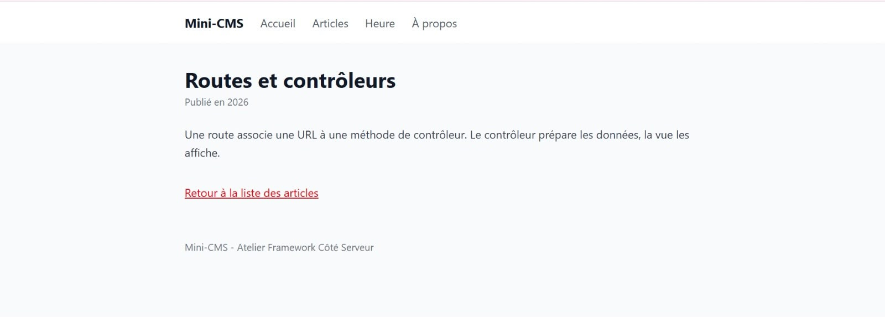

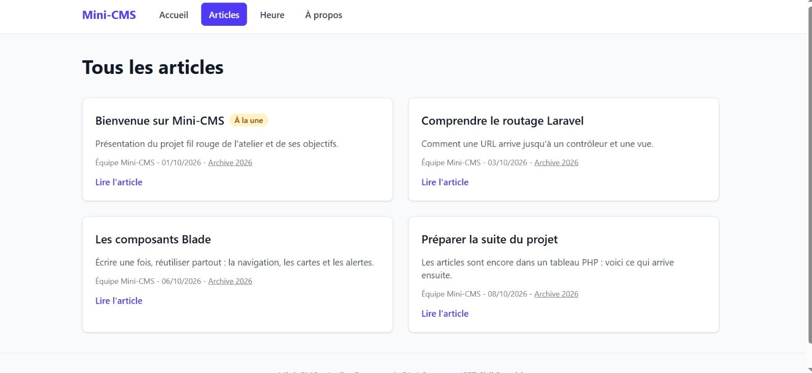

### Session 05


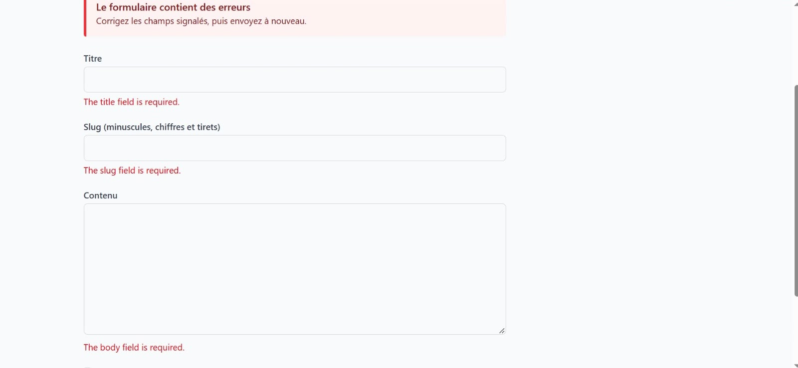

### Session 06


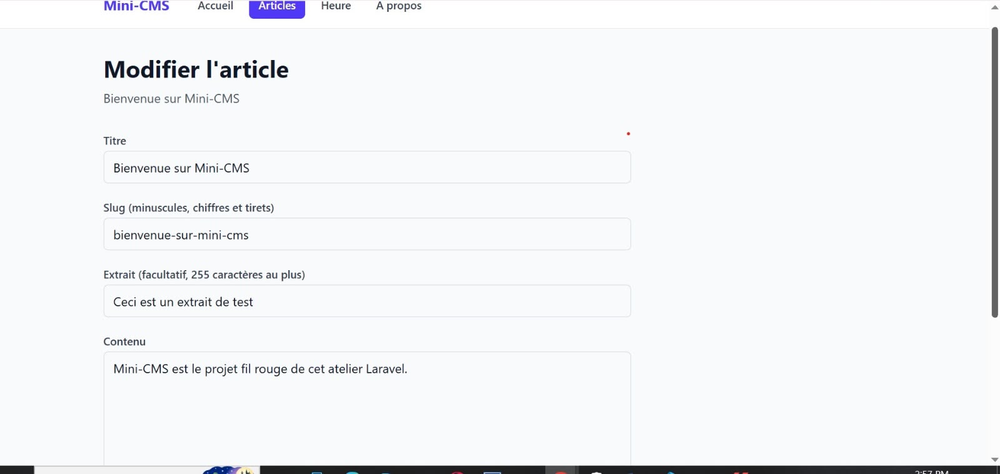

### Session 07

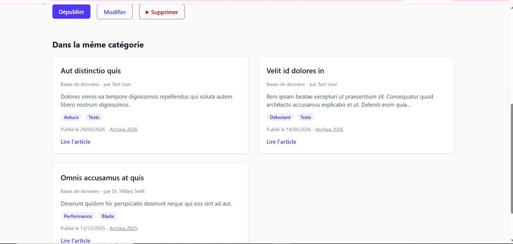


### Session 08


### Session 09

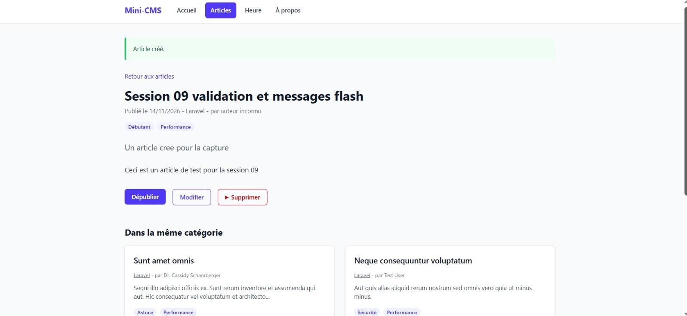


### Session 10

Back-office des catégories et des tags, messages de validation en français, pages 404 et 503 dans le layout du site.


### Session 11

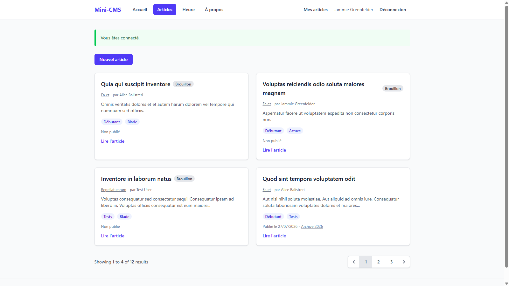

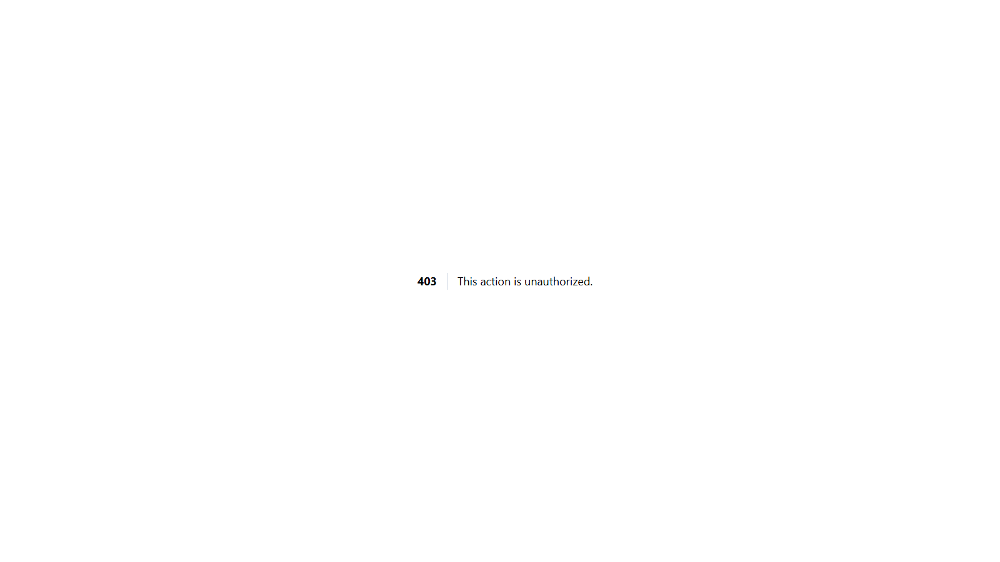

### Session 12


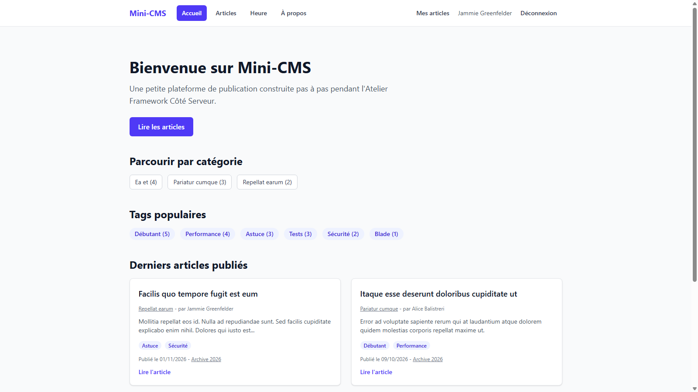

### Session 13

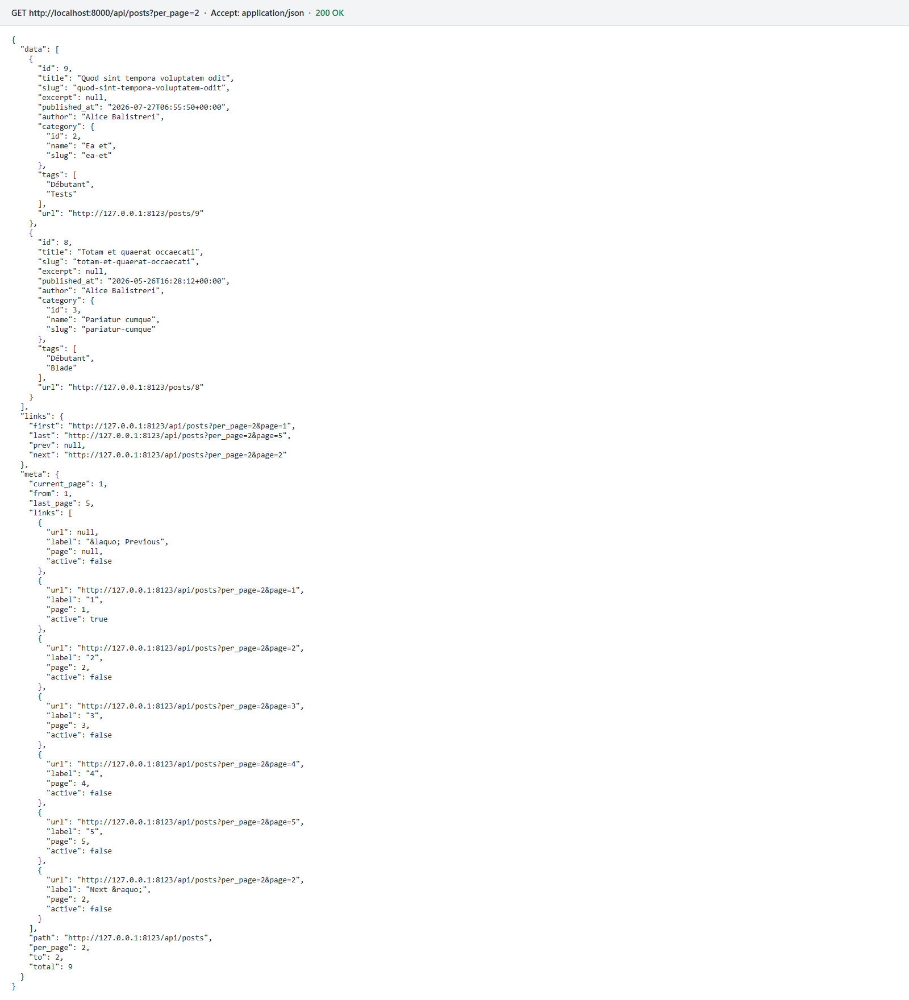

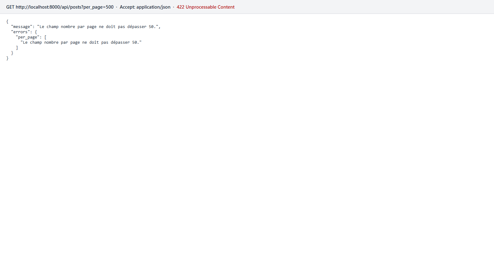

### Session 14

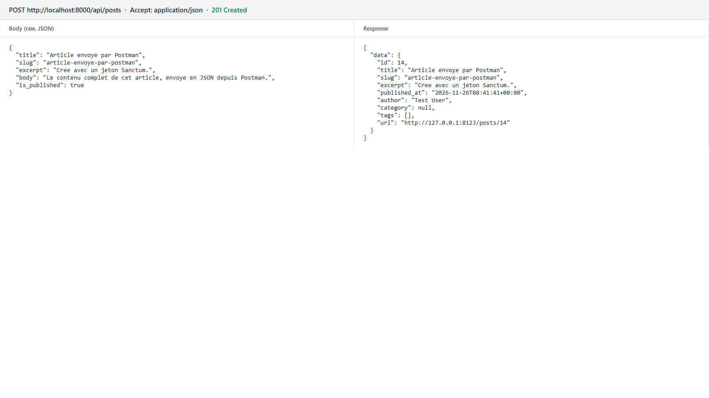

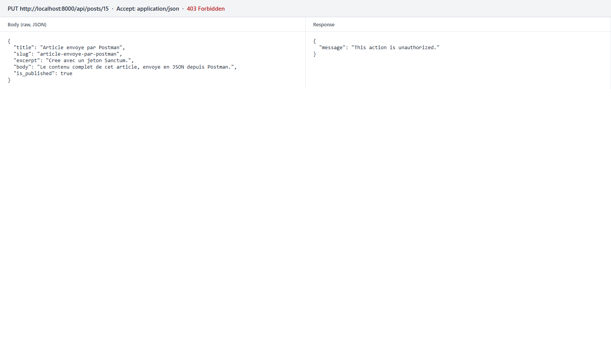

## Choix d'architecture

### Pourquoi les écritures de l'API passent par PostPolicy

Le site et l'API sont deux portes vers les mêmes articles. `Api\PostController` réutilise donc `StorePostRequest`, `UpdatePostRequest` et `PostPolicy`, au lieu d'écrire ses propres règles : une seule règle décide qui peut créer, modifier ou supprimer un article. Si cette règle change, le site et l'API changent ensemble, et l'API ne peut pas devenir un raccourci qui contourne les droits du site. L'autorisation (`authorize()`) passe aussi avant la validation : un client refusé reçoit 403 sans rien apprendre des règles.

### Pourquoi preventLazyLoading est activé

Une relation lue dans une boucle sans chargement anticipé (`with()`) lance une requête SQL par élément : c'est le problème N+1, invisible mais lent. `Model::preventLazyLoading(! app()->isProduction())` dans `AppServiceProvider` transforme ce problème en erreur visible en développement et pendant les tests, ce qui oblige chaque contrôleur à charger ses relations. En production, l'option est désactivée pour ne jamais casser une page devant un utilisateur.

### Pourquoi l'API utilise des jetons et non la session

Le groupe de routes `api` n'a ni session ni cookie : il répond à chaque requête sans se souvenir de la précédente. Un client qui n'est pas un navigateur (application mobile, script, Postman) ne garde pas de cookie de session et n'a pas de jeton CSRF ; il présente donc un jeton Sanctum à chaque requête. Chaque appareil a son propre jeton, que l'on peut révoquer seul (`/api/logout`) sans déconnecter les autres, et la base n'en garde que l'empreinte.

## Comparaison avec le starter kit Livewire

| Critère | Mini-CMS (authentification manuelle) | Starter kit Livewire |
|---|---|---|
| Routes d'authentification | `routes/web.php` (`/inscription`, `/connexion`, `/deconnexion`) | enregistrées par Fortify depuis son paquet ; absentes de `routes/web.php` |
| Inscription | `app/Http/Controllers/Auth/RegisterController.php`, `app/Http/Requests/RegisterRequest.php`, `resources/views/auth/register.blade.php` | `app/Actions/Fortify/CreateNewUser.php` (`Validator::make` puis `User::create`) et `resources/views/pages/auth/register.blade.php` |
| Connexion | `app/Http/Controllers/Auth/LoginController.php` (`store` : `Auth::attempt`, `regenerate`), `app/Http/Requests/LoginRequest.php` | contrôleur de Fortify et `resources/views/pages/auth/login.blade.php` |
| Déconnexion | `app/Http/Controllers/Auth/LoginController.php` (`destroy` : `logout`, `invalidate`, `regenerateToken`) | route `logout` de Fortify ; les mêmes trois opérations dans `app/Livewire/Actions/Logout.php` |
| Limitation des tentatives | aucune | 5 tentatives par minute par e-mail et adresse IP (`app/Providers/FortifyServiceProvider.php`) |
| Mot de passe oublié | absent | `Features::resetPasswords()` dans `config/fortify.php` |
| Vérification de l'e-mail | absente | `Features::emailVerification()`, `MustVerifyEmail` sur `User`, middleware `verified` sur `/dashboard` |
| Double authentification | absente | `Features::twoFactorAuthentication()` et `Features::passkeys()` |
| Rôles et autorisations | colonne `role` (`database/migrations/2026_11_26_082021_add_role_to_users_table.php`), Gates dans `app/Providers/AppServiceProvider.php`, `app/Policies/PostPolicy.php`, `app/Http/Middleware/EnsureUserIsAdmin.php` | aucun : à écrire soi-même |
| Tests | `tests/Feature/AuthTest.php`, `AuthorizationTest.php`, `AdminAccessTest.php`, `PostVisibilityTest.php` | 10 fichiers dans `tests/Feature` (Auth, Settings, Dashboard), écrits avec PHPUnit |

Ce que je garderais du kit dans un vrai projet : la limitation des tentatives de connexion, le mot de passe oublié et la vérification de l'e-mail, qui manquent à Mini-CMS et qu'il serait risqué de réécrire à la main. Les rôles, les Gates et la PostPolicy restent à écrire soi-même dans les deux cas, comme dans cette séance.
