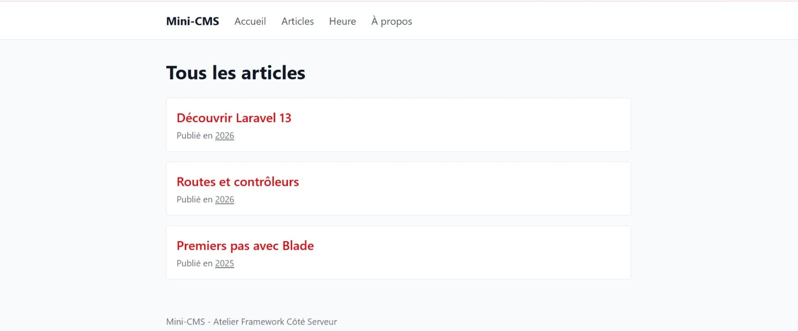
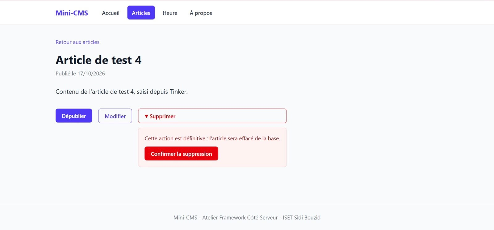
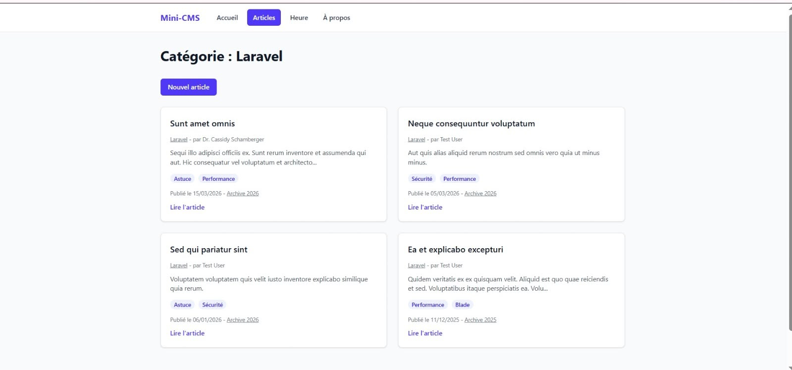
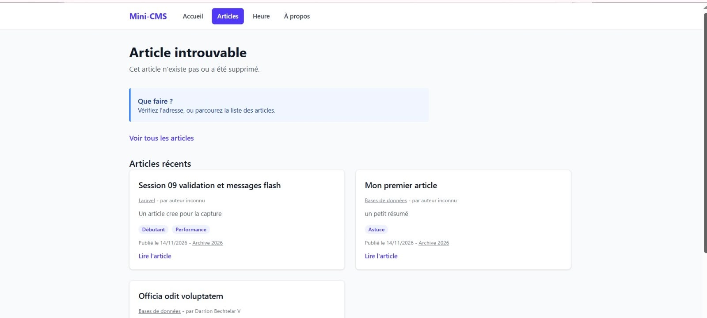
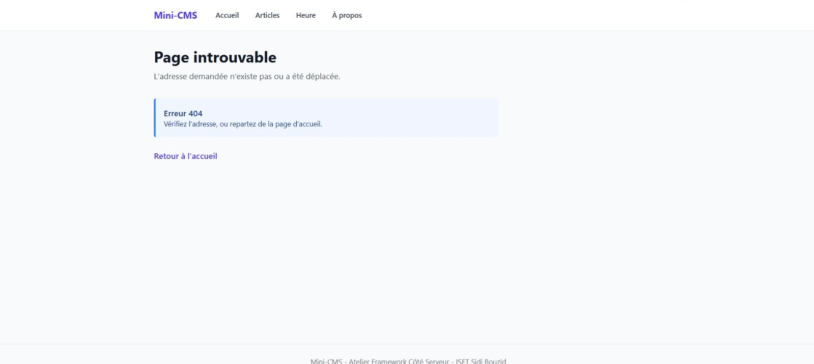

## État actuel (tag lab-06)

- Comptes écrits à la main : inscription (`/inscription`), connexion (`/connexion`) et déconnexion, avec `Hash::make`, `Auth::attempt` et la régénération de la session.
- Colonne `role` (`author` par défaut, `admin`). Après `php artisan migrate:fresh --seed`, le compte de démonstration `test@example.com` (mot de passe `password`) est administrateur.
- Écritures et back-office réservés aux utilisateurs connectés (middleware `auth`) ; chaque nouvel article est attaché à son auteur.
- Gate `manage-categories` : seuls les administrateurs gèrent les catégories.
- `PostPolicy` : un auteur modifie et supprime ses articles, un administrateur tous les articles.
- Tests Pest : `PostPagesTest`, `PostWriteTest`, `PostRelationsTest`, `PostTaxonomyTest`, `PostFeedbackTest`, `CategoryAdminTest`, `ErrorPagesTest`, `AuthTest` et `AuthorizationTest`.

## Routes disponibles

| Méthode | URI | Nom | Action |
|---|---|---|---|
| GET | `/` | `home` | `PageController@home` |
| GET | `/a-propos` | `about` | `PageController@about` |
| GET | `/heure` | `time` | `PageController@time` |
| GET | `/posts` | `posts.index` | `PostController@index` |
| GET | `/posts/archive/{year}` | `posts.archive` | `PostController@archive` |
| GET | `/posts/categorie/{category:slug}` | `posts.category` | `PostController@byCategory` |
| GET | `/posts/tag/{tag:slug}` | `posts.tag` | `PostController@byTag` |
| GET | `/posts/create` | `posts.create` | `PostController@create` |
| POST | `/posts` | `posts.store` | `PostController@store` |
| GET | `/posts/{post}` | `posts.show` | `PostController@show` |
| GET | `/posts/{post}/edit` | `posts.edit` | `PostController@edit` |
| PUT | `/posts/{post}` | `posts.update` | `PostController@update` |
| DELETE | `/posts/{post}` | `posts.destroy` | `PostController@destroy` |
| PATCH | `/posts/{post}/publication` | `posts.publication` | `PostController@togglePublication` |
| GET | `/admin/categories` | `admin.categories.index` | `CategoryController@index` |
| GET | `/admin/categories/create` | `admin.categories.create` | `CategoryController@create` |
| POST | `/admin/categories` | `admin.categories.store` | `CategoryController@store` |
| GET | `/admin/categories/{category}/edit` | `admin.categories.edit` | `CategoryController@edit` |
| PUT | `/admin/categories/{category}` | `admin.categories.update` | `CategoryController@update` |
| DELETE | `/admin/categories/{category}` | `admin.categories.destroy` | `CategoryController@destroy` |
| GET | `/admin/tags` | `admin.tags.index` | `TagController@index` |
| GET | `/admin/tags/create` | `admin.tags.create` | `TagController@create` |
| POST | `/admin/tags` | `admin.tags.store` | `TagController@store` |
| GET | `/admin/tags/{tag}/edit` | `admin.tags.edit` | `TagController@edit` |
| PUT | `/admin/tags/{tag}` | `admin.tags.update` | `TagController@update` |
| DELETE | `/admin/tags/{tag}` | `admin.tags.destroy` | `TagController@destroy` |
| GET | `/inscription` | `register` | `Auth\RegisterController@create` |
| POST | `/inscription` | `register.store` | `Auth\RegisterController@store` |
| GET | `/connexion` | `login` | `Auth\LoginController@create` |
| POST | `/connexion` | `login.store` | `Auth\LoginController@store` |
| POST | `/deconnexion` | `logout` | `Auth\LoginController@destroy` |
| GET | `/mes-articles` | `my-posts` | `PostController@myPosts` |

## Captures d'écran

### Session 01 à 04

### Session 05

### Session 06

### Session 07

### Session 08

### Session 09

### Session 10

Back-office des catégories et des tags, messages de validation en français, pages 404 et 503 dans le layout du site.

### Session 11

## Comparaison avec le starter kit Livewire

| Critère | Mini-CMS (authentification manuelle) | Starter kit Livewire |
|---|---|---|
| Routes d'authentification | `routes/web.php` (`/inscription`, `/connexion`, `/deconnexion`) | enregistrées par Fortify depuis son paquet ; absentes de `routes/web.php` |
| Inscription | `app/Http/Controllers/Auth/RegisterController.php`, `app/Http/Requests/RegisterRequest.php`, `resources/views/auth/register.blade.php` | `app/Actions/Fortify/CreateNewUser.php` (`Validator::make` puis `User::create`) et `resources/views/pages/auth/register.blade.php` |
| Connexion | `app/Http/Controllers/Auth/LoginController.php` (`store` : `Auth::attempt`, `regenerate`), `app/Http/Requests/LoginRequest.php` | contrôleur de Fortify et `resources/views/pages/auth/login.blade.php` |
| Déconnexion | `app/Http/Controllers/Auth/LoginController.php` (`destroy` : `logout`, `invalidate`, `regenerateToken`) | route `logout` de Fortify ; les mêmes trois opérations dans `app/Livewire/Actions/Logout.php` |
| Limitation des tentatives | aucune | 5 tentatives par minute par e-mail et adresse IP (`app/Providers/FortifyServiceProvider.php`) |
| Mot de passe oublié | absent | `Features::resetPasswords()` dans `config/fortify.php` |
| Vérification de l'e-mail | absente | `Features::emailVerification()`, `MustVerifyEmail` sur `User`, middleware `verified` sur `/dashboard` |
| Double authentification | absente | `Features::twoFactorAuthentication()` et `Features::passkeys()` |
| Rôles et autorisations | colonne `role` (`database/migrations/2026_11_26_082021_add_role_to_users_table.php`), Gates dans `app/Providers/AppServiceProvider.php`, `app/Policies/PostPolicy.php`, `app/Http/Middleware/EnsureUserIsAdmin.php` | aucun : à écrire soi-même |
| Tests | `tests/Feature/AuthTest.php`, `AuthorizationTest.php`, `AdminAccessTest.php`, `PostVisibilityTest.php` | 10 fichiers dans `tests/Feature` (Auth, Settings, Dashboard), écrits avec PHPUnit |

Ce que je garderais du kit dans un vrai projet : la limitation des tentatives de connexion, le mot de passe oublié et la vérification de l'e-mail, qui manquent à Mini-CMS et qu'il serait risqué de réécrire à la main. Les rôles, les Gates et la PostPolicy restent à écrire soi-même dans les deux cas, comme dans cette séance.
