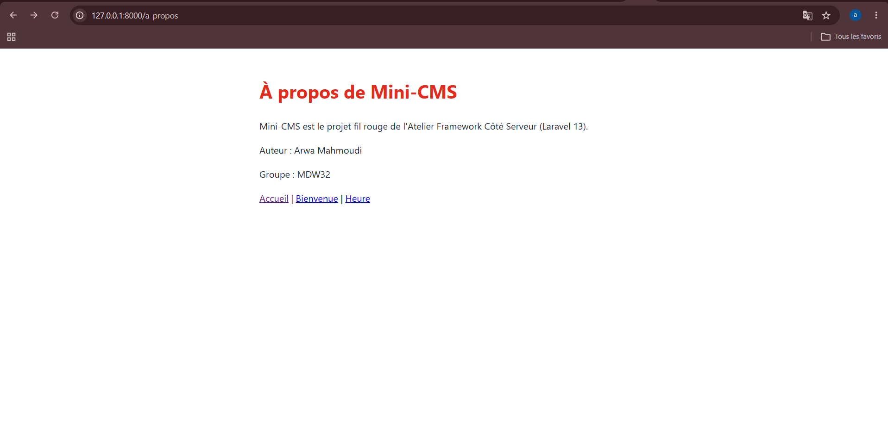

# Mini CMS — Projet Laravel

## Informations sur le projet

- **Étudiante :** Arwa Mahmoudi
- **Groupe :** MDW33
- **Framework :** Laravel
- **Dépôt GitHub :** https://github.com/arwamahmoudi506-arch/mini_cms

## Description

Ce projet est réalisé dans le cadre des travaux pratiques de Git et Laravel. Il permet de découvrir la gestion des versions avec Git et de créer des routes et des pages web avec Laravel.

## Pages réalisées

- `/` : page d'accueil
- `/bonjour` : page Bonjour
- `/bonjour-court` : page Bonjour courte
- `/version` : informations sur la version
- `/a-propos` : page À propos du projet

## Captures d'écran

### Page d'accueil


### Page Bienvenue


### Liste des routes


### Page À propos



## Installation

### Prérequis

- PHP
- Composer
- Node.js et npm
- Git

### Étapes d'installation

```bash
git clone https://github.com/arwamahmoudi506-arch/mini_cms.git
cd mini-cms
composer install
npm install
cp .env.example .env
php artisan key:generate
```

Créer la base de données SQLite, puis exécuter les migrations :

```bash
touch database/database.sqlite
php artisan migrate
```

Lancer le projet :

```bash
composer run dev
```

## État du projet

La page À propos a été ajoutée et enregistrée dans Git. Le projet continue d'évoluer au fil des séances pratiques.